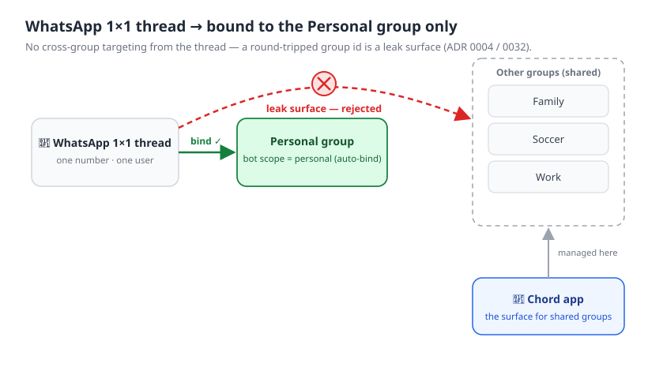
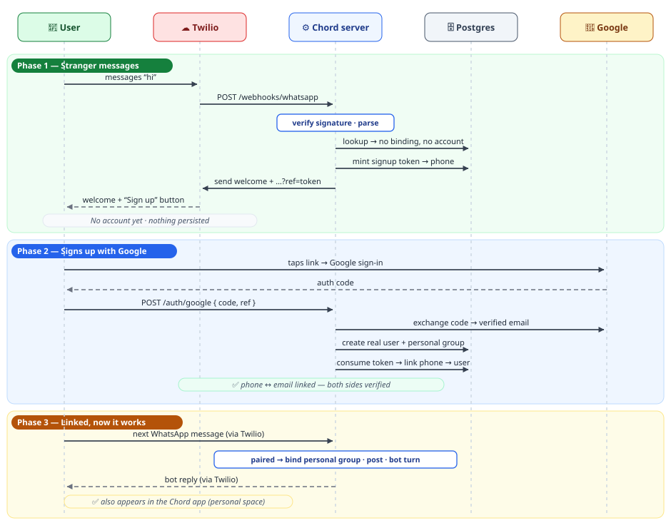

# 0053 — WhatsApp connector via Twilio (24-hour window + template gating)

**Status**: accepted — implemented: connector (reactive, text-only) + Google-referrer onboarding. Fast-follows: proactive templates, interactive buttons, media
**Date**: 2026-06-12

## Context

Today a user reaches Chord either through the mobile app or through an IM
connector (Slack, Discord, Telegram — [ADR 0010](./0010-im-connectors.md)).
We want to add WhatsApp as a surface: the user messages a Chord-owned
WhatsApp number instead of (or alongside) the app. By design this is a
**1×1 always-on** channel — one number, one user, the user is logged in,
and ideally has the app installed. This maps exactly onto the existing
**personal-group auto-bind** path (`maybeAutoBindForPairedSender` in
`inbound-pipeline.ts`): a paired user's DM binds to their personal group,
all messages visible, bot always replies. No new "private channel"
concept is needed.

The connector layer is already platform-pluggable behind the `Connector`
interface (`services/connectors/types.ts`), and Slack/Discord are already
**webhook-based**, which is the shape Twilio needs. So most of the work is
a new connector dropped into existing plumbing plus the onboarding shape
we already use for Telegram ([ADR 0031](./0031-uuid-signup-soft-link.md)).

The one place WhatsApp departs sharply from Telegram is **outbound
freedom**. Telegram lets the bot DM a paired user at any time. WhatsApp
does not. The WhatsApp Business Platform enforces a **24-hour customer
service window**:

- The window is opened — and **reset** — only by a *user-initiated*
  inbound message. The business's own outbound messages never open it.
- While the window is open (last inbound < 24h ago), the business may send
  **free-form** messages: bot replies, follow-ups, file sends, the daily
  nudge body — all uncapped, no template.
- Each new inbound message slides the 24h clock forward from that message.
  An actively-chatting user keeps the window continuously open.
- When 24h pass with no inbound, the window closes. To speak first again,
  the business must send a **Meta-pre-approved message template**. A
  template is the *only* way to write into a closed window.
- Billing is per-24h **conversation** (categorized utility / marketing /
  service / authentication), not per message. Opening a conversation with
  a template, then exchanging free-form messages inside it, is one
  billable conversation.

This directly constrains our proactive paths — the daily briefing
([ADR 0034](./0034-configurable-nudge-time.md)) and the calendar-reconnect
nudge ([ADR 0042](./0042-proactive-calendar-reconnect-nudge.md)) both
assume Telegram's "DM anytime" freedom, which does not hold on WhatsApp.

### Worked example (the daily nudge)

| Time  | Event                                                | Window |
|-------|------------------------------------------------------|--------|
| 08:00 | Chord sends **template** "Good morning, want your nudge?" | closed — template is how you write into a *closed* window; it does **not** open one |
| 08:05 | User replies "yes"                                    | **opens** at 08:05 → free-form allowed until next-day 08:05 |
| 08:05 | Chord sends the actual nudge body (free-form)         | ✅ no template |
| 11:30 | User: "add milk to the list"                          | window **resets** → open until next-day 11:30 |
| 11:30 | Bot reply, file sends, follow-ups                    | ✅ free-form |

The morning template's only job is to **bait a reply that opens the
window**. If the user ignores it, the window never opens and that day's
nudge body cannot be pushed free-form (it would require a *second* template
to deliver directly — allowed, but a second billed conversation and the
kind of high-frequency utility template Meta scrutinizes).

## Decision

1. **Add a `whatsapp` connector implementing the existing `Connector`
   interface**, routed through the existing `POST /api/v1/webhooks/:platform`
   endpoint. Twilio-specific pieces: `verifySignature` (validate
   `X-Twilio-Signature`, HMAC-SHA1 over the full URL + sorted POST params),
   `parseInbound` (Twilio posts `application/x-www-form-urlencoded`, not
   JSON — the route needs a urlencoded body parser and the raw body for
   signature validation), `send` (Twilio Messages REST API), and media
   (inbound = authenticated `MediaUrlN` fetch; outbound = a public URL, not
   a multipart upload like Telegram).

2. **Shared deploy-wide number for the MVP**, not BYO-number per user. The
   webhook route is already deploy-wide by construction (one webhook URL per
   platform → the deploy-wide bot). BYO numbers (mirroring the
   [ADR 0025](./0025-byo-connector-tokens.md) BYO-token path) would add
   Twilio subaccount/number provisioning and are deferred.

3. **Reuse the Telegram onboarding shape verbatim**: Google-only sign-in
   ([ADR 0014](./0014-google-only-auth.md)), UUID-referrer soft-link
   ([ADR 0031](./0031-uuid-signup-soft-link.md)), shadow users on first
   sighting (`external_user_id` = the E.164 number, e.g. `whatsapp:+1555…`;
   display = Twilio `ProfileName`). **Implemented by generalizing the
   referrer flow, not cloning it**: `mintForTg`→`mintSignupIntent(platform,…)`
   and `consumeForTg`→`consumeSignupIntent` (the token row carries its own
   platform, so the existing `/auth/google` consume + the mobile `signupRef`
   forwarding cover WhatsApp unchanged — no mobile work). The welcome-DM
   mints for any `REFERRER_PLATFORMS` member and its copy is platform-aware
   (no pair-code line for WhatsApp — it has no pair-code fallback). The signup
   link is a **bare URL** (WhatsApp auto-linkifies it, so `SIGNUP_URL` must be
   a real domain, never `localhost`) on the **claimed `/welcome/<ref>`
   deep-link path** (ADR 0048): on a device it opens the native app — AASA +
   the Android intent-filter now claim `/welcome/*` — which stashes the ref
   and resumes after Google sign-in; on web it resolves the same
   `app/welcome/[ref]` route. Native deep-linking needs
   `SIGNUP_URL=https://chordapp.ai` (the verified apex). The 1×1 always-on
   behavior is the existing personal-group auto-bind — no new code path. NB: under `AUTH_MODE=demo` the pipeline auto-provisions before the
   welcome path, so onboarding only exercises under `AUTH_MODE=google`.

4. **Gate all proactive (business-initiated) sends on window state.**
   Introduce an `isWindowOpen(platform, externalUserId)` check —
   "last inbound from this user < 24h ago" — at the proactive boundary:
   - **Window open** → send the nudge / reconnect card free-form, exactly
     as Telegram does today.
   - **Window closed** → send an approved **template** whose purpose is to
     re-open the window (e.g. "Good morning — want your daily nudge?"), and
     deliver the real content when the user replies. Never attempt a
     free-form proactive send into a closed window; Twilio will reject it.

   Reactive replies (the user just messaged, so the window is open by
   definition) need no gating and are unaffected.

5. **MVP ships reactive-only.** Free-form 1×1 conversation — user messages
   the number, bot replies — works the moment the connector lands, with no
   template approval. The proactive template layer (item 4) is a fast-follow
   so the daily nudge can reach quiet users; it is gated on Meta template
   approval, which runs in parallel and does not block the MVP.

6. **The window is per-recipient, and "invoke" does not imply "open."** The
   24h window is a property of the WhatsApp transport, keyed to
   `(WhatsApp user ↔ our business number)`. It is opened *only* by that
   specific user's inbound WhatsApp message — nothing inside the app (the
   user being logged in, active, or invoking the bot in-app) touches it.
   So the only path with a guaranteed-open window is **a reply to an inbound
   WhatsApp message, sent back to that same user**. Every other outbound is
   business-initiated and must be gated: an in-app invoke whose result we
   push to WhatsApp, a group message fanned out to *another* member's
   WhatsApp thread (gated by *that* member's last inbound, not the sender's),
   or any scheduled nudge. There is no way to "warm" the window from the
   app — the opener must be a genuine message from the user's WhatsApp
   client.

7. **The WhatsApp thread is bound to the user's personal group, full stop —
   no cross-group targeting.** A WhatsApp user has exactly one 1×1 thread but
   may belong to several Chord groups. We do **not** let the thread address
   other groups (no "which group?" list-picker, no group id in a button
   payload). The thread is just another strictly-scoped surface, permanently
   bound to the personal group via the existing auto-bind, and the bot turn
   is scoped to that group like any other ([ADR 0004](./0004-group-scoped-agent.md)
   / [ADR 0032](./0032-strict-per-group-scope.md)). Shared groups are reached
   only through the app.

   The reason is **leak surface**, not convenience. A button payload
   round-trips through the user's WhatsApp client, so a `groupId` carried in
   it is attacker-influenceable; even with a server-side `isMember` re-check,
   letting one always-on 1×1 thread aim writes at *any* of the user's groups
   widens the blast radius and erodes the strict per-group guarantee that
   every other surface upholds. Binding to personal keeps the invariant
   airtight: the thread can only ever touch personal-group data.

   

   Interactive buttons are still used — but only **within** the personal
   group: `twilio/quick-reply` (≤3, in-session, no approval) for confirmations
   and consensus proposals ([ADR 0009](./0009-consensus-before-commit.md)), and
   `twilio/list-picker` (≤10) to disambiguate *entities inside the personal
   group* (e.g. "which list?"). On tap, Twilio returns `ButtonPayload`;
   `parseInbound` decodes it and the executor acts — always within personal
   scope. This is the WhatsApp analog of the Telegram `callback_data` actions
   ([ADR 0029](./0029-tg-inline-actions.md)). Consequence for the user:
   "add to the family grocery list" sent over WhatsApp does **not** write to
   the family group — the bot acts in personal scope or points the user to the
   app for shared groups.

8. **Taster before the gate: serve unsigned strangers for a bounded,
   billed allowance, then require signup.** A hard app-first gate (the
   Telegram-DM behavior) means a WhatsApp stranger gets *zero* value before
   committing to an account — high friction on a surface where the phone is
   already verified. Instead, an unsigned WhatsApp DM is served under a
   **shadow account** for up to `WHATSAPP_TASTER_TURNS` (default 10) reactive
   bot turns; after that the welcome/signup nudge takes over. The cap exists
   because WhatsApp turns cost real money (paid conversations + LLM calls) —
   it bounds the cost/abuse the hard gate was protecting against while
   keeping a "try before you sign up" funnel. On Google sign-in,
   `consumeSignupIntent → mergeOrLinkExternalIdentity` merges the shadow's
   data (lists, reminders, personal group) into the real account, so nothing
   is lost. Mechanics worth noting:
   - **The taster binds the channel** (to the shadow's personal group) so the
     bot's reply actually reaches WhatsApp — the outbound publisher routes by
     binding, so an unbound thread would reason correctly but deliver nothing.
     The per-turn limit is therefore enforced at the **reaction gate**
     (`tasterAllowanceSpent`), which runs even for bound channels, rather than
     at the binding lookup — so binding doesn't bypass the allowance.
   - **Turns are counted as reactive `bot` messages** in the shadow's
     personal group (proactive nudges excluded) — a stateless proxy for
     "billed LLM turns," no counter column.
   - **`ensurePersonalGroup` runs *after* the referrer consume** at sign-in,
     so the merged shadow's personal group is adopted as the user's one
     personal group instead of creating a duplicate.
   - **WhatsApp-only.** Telegram keeps its existing behavior (DMs gated,
     groups serve shadows). `WHATSAPP_TASTER_TURNS=0` restores the hard gate.
   - Under `AUTH_MODE=demo` the demo auto-provision still wins first (unsigned
     dev users are served unlimited), so the taster path only exercises under
     `google`.

### Addendum — post-limit nudge cadence + merge robustness

Corrections after a prod run (2026-06-21) where a returning user's WhatsApp
number never linked to their existing Chord account.

- **Root cause of the failed merge: a missing FK in the re-attribution
  list.** The shadow created a calendar event during the taster, so
  `events.owner_user_id` / `events.organizer_user_id` (ADR 0040) and an
  `event_attendees.user_id` row pointed at the shadow. `mergeOrLinkExternalIdentity`
  ends with `DELETE FROM users WHERE id = shadowId`, but
  `reattributeShadowFkColumns` didn't re-point those three NO-ACTION columns,
  so the delete threw `events_owner_user_id_fkey` and — because the whole
  consume is one transaction — rolled back the *entire* merge. The identity
  re-point, membership migration, everything reverted; nothing linked. Fix:
  add the three columns to the re-attribution list. The list must stay
  exhaustive over every NO-ACTION (`confdeltype='a'`) FK to `users(id)` —
  `CASCADE`/`SET NULL` columns self-handle, but a new authored table with a
  plain FK will silently reintroduce this.

- **The signup nudge re-sends on every message once the allowance is
  spent**, not once per `WELCOME_DM_REGREET_DAYS` cooldown. The taster has
  already had its free turns, so the only useful reply is "go sign up";
  `maybeWelcomeStranger(db, m, { alwaysSend: true })` from the taster-spent
  gate bypasses the `connector_dm_greeted` cooldown. The WhatsApp copy is a
  dedicated "you've used your quota of free messages → sign up to continue"
  message carrying the `/welcome/<ref>` link.

- **An already-signed-in user can also consume the referrer token.** The
  merge previously ran *only* on a fresh `POST /auth/google` with
  `signupRef`. A returning user who clicks the welcome link while already
  authenticated never re-runs OAuth, so the stashed token would never be
  consumed. New endpoint `POST /me/link-signup-ref` (session-authed) runs
  the same consume for the current user; mobile `app/index.tsx` calls it
  from a `user`-keyed effect whenever a pending `signupRef` is in
  AsyncStorage. Idempotent — a stale or already-consumed token is a no-op.

- **Merging a taster shadow into a user who already has a personal group
  must consolidate, not split.** The taster gives the shadow its own
  personal group (calendar, lists, the bound WhatsApp channel). For a brand
  new signup that group simply *becomes* the user's personal group. But for
  a *returning* user who already had one, `mergeOrLinkExternalIdentity` only
  re-attributed the shadow's group to them — leaving **two** personal groups
  with the connector binding + Google calendar on one and the rest of their
  data on the other. Symptom in prod: WhatsApp ("what's on my calendar?")
  was bound to the near-empty taster group and answered "no events" while
  the user's 684 synced events lived in their original group (the bot's
  calendar context is group-scoped — `listEvents(db, groupId)` in
  `context.ts`). Fix: `consolidatePersonalGroupInto(tx, from, to)`
  (`groups.service.ts`) folds the taster group entirely into the owner's
  existing personal group — every `group_id`-scoped table (incl. `events`
  with its `group_ids` JSONB), connector bindings, and attachment scopes —
  then deletes the emptied source. The merge captures both personal groups
  *before* re-attribution and consolidates when they differ.
  `ensurePersonalGroup` also now resolves the **oldest** personal group
  deterministically, so a transient duplicate never picks the wrong one.
  The merge also calls `rescheduleDailyScanForUser` afterward: the shadow
  owned a personal group, so it had its own `daily_morning_scan`,
  re-attributed to the owner — leaving a **duplicate morning briefing**
  whose payload still named the deleted shadow (rendering an empty one).
  Reschedule collapses the owner to a single, correctly-attributed scan.

## Outbound decision: the `deliverToWhatsApp` helper

Every WhatsApp-bound message routes through a single question — *is **this
recipient's** window open?* — so the window logic lives in one helper, not
scattered across each feature (daily nudge, in-app invoke result, group
fan-out, ADR 0009 proposal):

```
deliverToWhatsApp(user, payload):

  scope is always the user's personal group (decision item 7)

  trigger = reply to this user's inbound WhatsApp msg?
    ├─ YES → window OPEN by definition
    │        └─ send free-form + quick-reply buttons (≤3, no approval),
    │           payload = action + entity id          → applied in personal scope
    │
    └─ NO  → isWindowOpen(user)?  (last inbound < 24h)
             ├─ OPEN   → send free-form / interactive directly
             │           (same as the reply path)     → applied in personal scope
             └─ CLOSED → send approved TEMPLATE (re-opener only; no payload)
                         └─ user replies?
                            ├─ YES → window now open → deliver content +
                            │        action buttons   → applied in personal scope
                            └─ NO  → deferred; retry next window / cycle

  safety net: a free-form send that races a just-closed window fails with
  Twilio error 63016 → fall back to the TEMPLATE branch.
```

Both "open" routes (reply path, and a business-initiated send that finds the
window already open) converge on the **same** free-form-plus-buttons action,
so there is one code path for "open." The template branch is the *only* place
templates appear, and the template is a dumb re-opener — it carries no action
payload, because real content + buttons only flow once the user's reply opens
the window. The helper owns the gate, the free-form-vs-template choice, the
personal-scope button payloads, and the 63016 fallback; callers pass a logical
`payload` and never reason about the window themselves.

## Onboarding sequence (cold inbound, `AUTH_MODE=google`)

When a stranger messages the WhatsApp number *before* having a Chord account,
the flow is the Telegram referrer flow generalized (decision item 3). The
defining property: **no account or data is created until the user actually
signs in with Google** — a stranger gets only a welcome and an invisible
`signup_intents` token.



1. **Stranger messages** → webhook → `verifySignature`/`parseInbound` → pipeline
   finds no binding and no account → `maybeWelcomeStranger` mints a
   `whatsapp` signup token and replies with a `…?ref=<token>` link (reactive,
   so in-window — free-form, no template). **No shadow user, nothing
   persisted, no bot turn.**
2. **User taps the link, signs in with Google** → `/auth/google` creates the
   real user + personal group, then `consumeSignupIntent` re-points the
   `external_identities` row for the phone to that user and stamps the email
   on the intent (the verified **phone↔email** record).
3. **Next message** → the sender is now paired → auto-bind to their personal
   group → bot replies via Twilio, and it's visible in the Chord app.

Under `AUTH_MODE=demo` step 1 instead auto-provisions a throwaway account
before the welcome path — onboarding only exercises under `google`.

## Alternatives considered

- **Treat WhatsApp like Telegram and DM proactively whenever we want** —
  not possible. WhatsApp rejects business-initiated free-form messages
  outside the 24h window at the API level. Ignoring this means the daily
  nudge silently fails for exactly the quiet users it's meant to re-engage.

- **Always lead the daily interaction with a template** (template every
  morning regardless of window state) — simpler control flow, but wasteful:
  it spends a billed utility conversation even for users who already chatted
  in the last 24h (window already open → free-form would do), and piles up
  high-frequency utility templates that draw Meta quality review. The
  `isWindowOpen` gate sends a template only when actually needed.

- **Cross-group targeting from the thread via a membership-gated list-picker**
  — rejected as a leak surface (decision item 7). Even with a server-side
  `isMember` re-check, a `groupId` that round-trips through the user's WhatsApp
  client lets one always-on 1×1 thread aim writes at any of the user's groups,
  widening the blast radius and weakening the strict per-group invariant
  ([ADR 0004](./0004-group-scoped-agent.md) / [ADR 0032](./0032-strict-per-group-scope.md)).
  Personal-only binding is the conservative choice; shared groups stay in the
  app. Revisit only with a hardened, server-minted (not client-supplied)
  target reference if a real need emerges.

- **BYO WhatsApp number per user** — defer. Adds Twilio subaccount/number
  lifecycle with no MVP benefit; the shared-number model is what the
  webhook plumbing already assumes.

- **Poll instead of webhook (Telegram-style long-poll)** — Twilio has no
  long-poll equivalent; it is webhook-push only. We already have the
  webhook route, so this is moot.

## Consequences

- **A new `isWindowOpen` boundary in the proactive layer.** Any current or
  future business-initiated send (daily briefing, calendar-reconnect, future
  alerts) must route through it on WhatsApp. Telegram/Slack/Discord ignore
  it (always-open). Worth centralizing so new proactive features inherit the
  gate instead of each re-discovering the 24h rule.

- **Tracking last-inbound timestamp per user.** We already persist inbound
  messages with `source` + timestamps; window state is derivable from the
  latest inbound for `(platform='whatsapp', external_user_id)`. No new
  table required, but the query must be cheap (it runs on every proactive
  send).

- **Template authoring + Meta approval is external lead time** (days to
  weeks) and gates the proactive fast-follow, not the MVP. The Twilio
  WhatsApp **Sandbox** lets us build and test the entire connector
  immediately with no approval; production launch additionally needs a
  WhatsApp Business Account, Meta business verification, and sender
  registration. Start that paperwork on day one, in parallel with coding.

- **Interactive buttons — implemented via the Content API; resolution is a
  follow-up, never an edit.** The plain Messages API body is text-only, but
  the **Content API** gives real tappable buttons. `whatsapp.renderer.ts`
  turns **callback** action cards into a `twilio/quick-reply` send (≤3
  in-session, **no template approval**); the button `id` carries the same
  `verb:id` payload Telegram puts in `callback_data`, echoed back as
  `ButtonPayload` on tap. `parseInbound` surfaces that as `buttonPayload`, and
  `handleInbound` routes it through the now-platform-generic `handleCallback`
  (proposal confirm/reject, membership-checked) — the same logic Telegram
  uses. **The crucial difference: WhatsApp has no message-edit API**, so
  there's no greying-out the buttons in place (the Telegram ADR 0029 move).
  Instead the outcome is posted as a **follow-up message**, and a stale tap on
  an already-resolved proposal returns an idempotent "Already resolved." So
  `editActionButtons` stays a deliberate no-op on WhatsApp, and
  `outbound_connector_messages` (which only feeds in-place edits) is moot here.
  Quick-reply needs pre-created Content templates keyed by button count
  (`TWILIO_QUICK_REPLY_SID_2` / `_3`); **unset → buttons gracefully degrade to
  plain text** (URL action cards stay tappable as bare links regardless).

- **Shared-group activity is not delivered to WhatsApp at all.** Because the
  thread is bound to the personal group only (decision item 7), the ADR 0011
  shared-group fan-out does **not** mirror into a user's WhatsApp thread —
  doing so would surface another group's content on a personal-scoped surface,
  the same leak we're avoiding. WhatsApp is a 1×1 personal assistant; all
  shared-group participation (reading the feed, posting to the group) happens
  in the app. This also sidesteps the per-recipient 24h-window problem that
  would otherwise make group mirroring unreliable.

- **Adding `'whatsapp'` to the `ConnectorPlatform` union** touches ~29 files
  (schema, kernel types, SSE map, renderers, mobile status UI) — mechanical
  but wide; expect to update them in one pass.

- **If/when proactive volume grows**, revisit template categories and the
  one-conversation-per-day assumption against Meta's pricing and quality
  ratings. Noted here so a future reader doesn't mistake "one template each
  morning" for a free operation.

## Addendum (2026-08-21) — the ask rides the answers, and the cap drops to 5

The taster shipped as ten silent answers followed by a hard wall. In
practice that is the worst available shape, for three reasons that only
became obvious watching a real person fail to onboard:

- **The ask was attached to a refusal.** The first thing we ever said about
  Chord arrived bundled with "you've run out", so the proposition was *link
  your account to get back what you just lost* rather than *…to get more*.
- **It wasted peak intent.** The best moment to ask is immediately after the
  bot has visibly helped. We were deliberately silent for exactly that
  window and asked at the coldest possible moment.
- **Nobody knew who was talking.** `maybeTasterServe` returns a group, so
  `maybeWelcomeStranger` never runs — turn 1 was a bare answer from an
  unidentified number.

Now the connect prompt is a footer on the taster's own replies
(`whatsapp/taster.ts`, appended in `outbound-publisher`), with three voices:
an introduction, a periodic reminder, and a final notice on the last free
answer so the wall is never a surprise.

The cadence is derived from the allowance rather than fixed — first turn,
every third, and the last — so it adapts to whatever `WHATSAPP_TASTER_TURNS`
is set to (at 10: turns 1, 3, 6, 9, 10; at 5: 1, 3, 5; at 2: 1, 2). The cap
itself stays at **10**. Lowering it was considered and rejected: the reason
10 looked expensive was that all ten turns bought zero awareness, and once
the ask rides along, those turns are doing conversion work rather than being
burned silently. The number is a prod knob to tune against real behaviour,
not something to guess at from the code.

Copy is written for someone who **already has Chord**, not only a newcomer.
The common case is a signed-up user messaging from a number we cannot yet
tie to them (the whole reason they are a shadow), and "sign up" is the wrong
instruction for them — it reads as *make a second account*. Hence "Connect
this chat to your Chord account", the same wording on the wall message and
on the action card, and a test that asserts the strings never say "sign up".
The wall also loses "you have used your quota of free messages", which
framed an account gate as a paywall.

`tasterAllowanceSpent` became `tasterState`, returning the turn count it
already computed instead of throwing it away behind a boolean — the footer
cadence and the "one left" notice both need the number. It takes the user
the allowance is charged to: the sender inbound, the personal group's owner
outbound (where the message being sent is the bot's own). The turn number
**counts the reply going out**, since it is persisted before the SSE
broadcast the publisher reacts to; an integration test pins that, because
off by one puts the footers on the wrong turns or drops them entirely.

The referrer token is minted against the WhatsApp channel id, which for a
1:1 is the user, and minting is idempotent — a re-send reuses the open
intent rather than forking a fresh link. A mint failure logs and drops the
footer: it is never worth failing a reply over.
