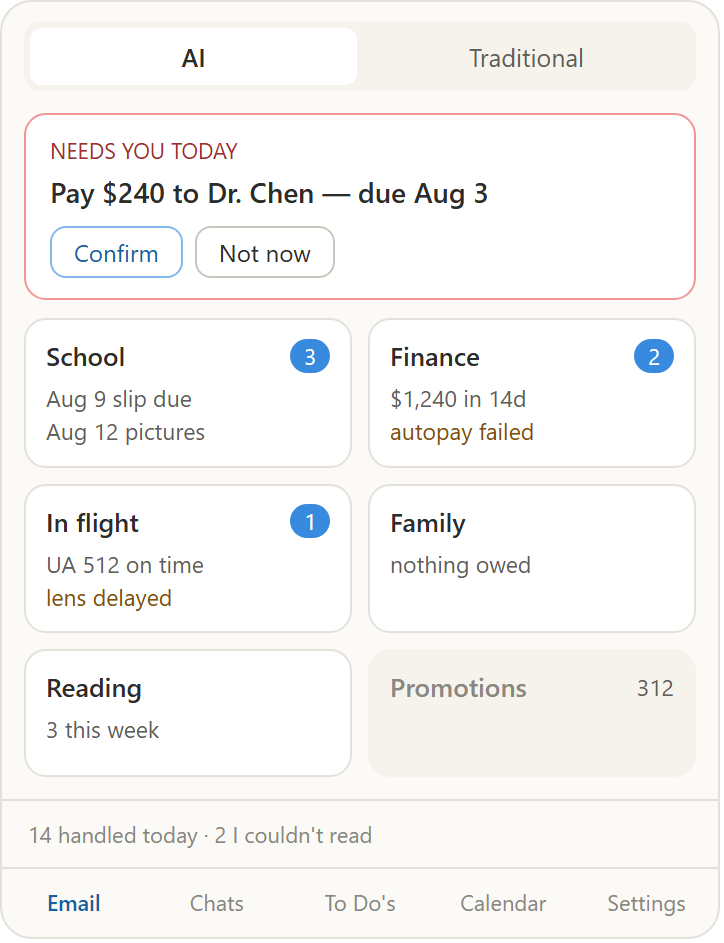
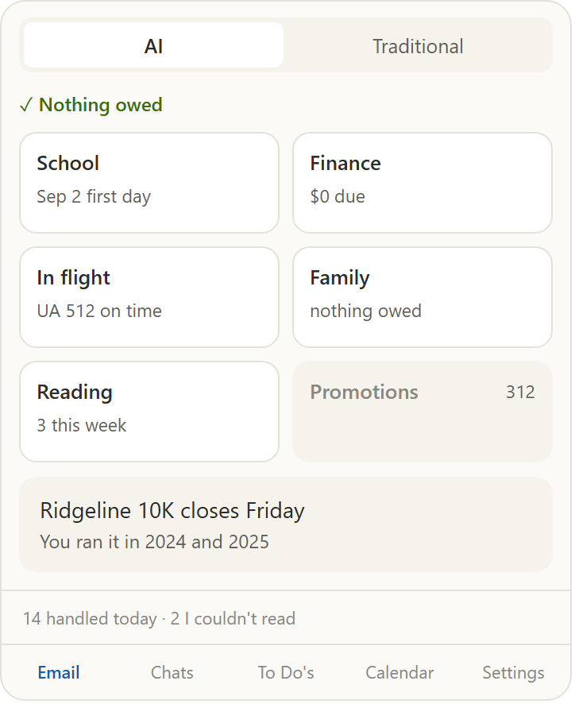
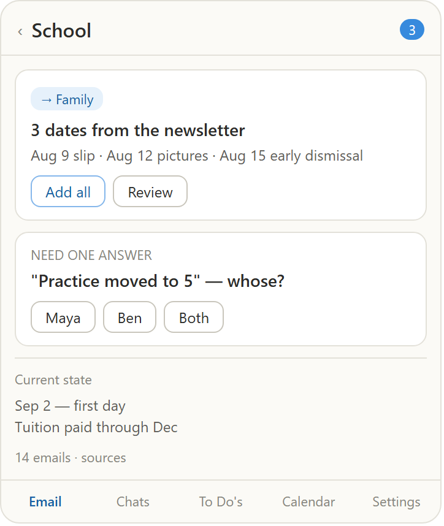
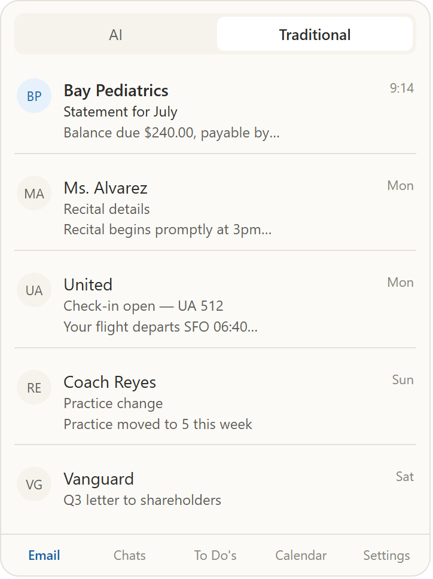
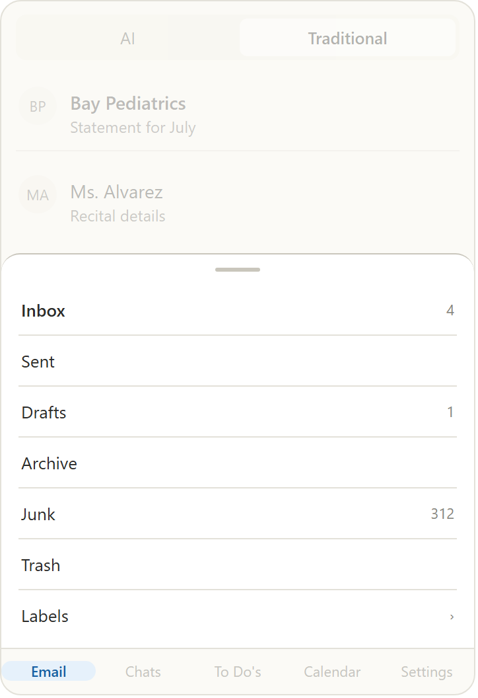
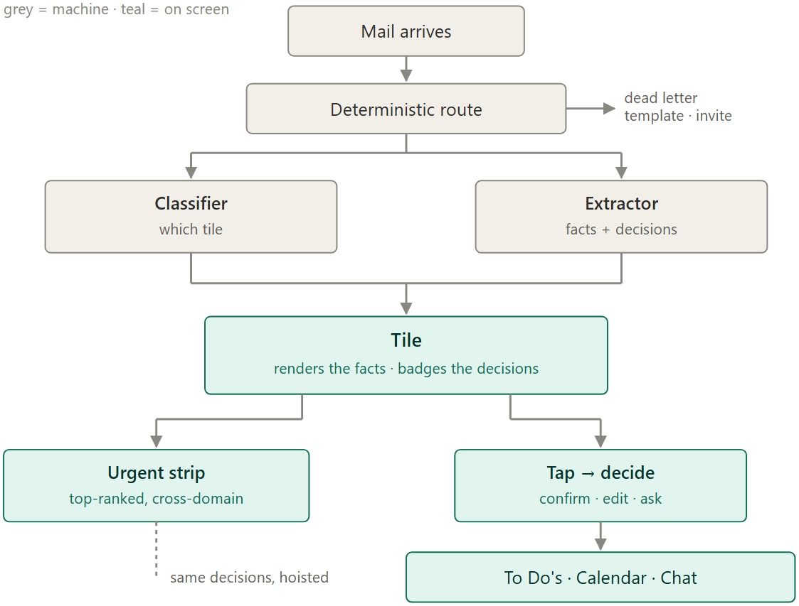

# The email reader

**Written**: 2026-07-29

> **Status (2026-08-17):** **Stage 1 shell + Stage 2 facts + Stage 3a context** —
> [ADR 0083](../notes/0083-email-stage-1-shell-decisions-on-tiles.md),
> [ADR 0087](../notes/0087-email-tile-archetype-facts.md),
> [ADR 0088](../notes/0088-email-magics-world-context.md). Magics see the
> calendar before extracting. Stage 3b conflict-on-card and Stages 4–5 remain.

## Context

Chord's email surface was built by asking "how do we show the user their mail,
but smarter?"

The brief was to design clean-sheet and to question whether a person must read and answer their mail at all. if they need to answer, what is the suggested answer.

**The right way to read email is to decide what the next step is. It's a decision tree where the majority resolves to doing nothing, and a few resolve into a short pipeline of decisions.**

---

## 1. What email actually is

1. **Anyone can write to you without permission.** This is the source of both
  its value and its pain.
2. **It's the household system of record.** Receipts, tickets, policies, lab
  results. Not because it's a good filing cabinet — because it's the one  
   everybody has.

## 2. What arrives, sorted by what you owe

Not by sender generally — unless the sender is important — or by topic. By
obligation.

| Bucket          | You owe                                                          | Share  |
| --------------- | ---------------------------------------------------------------- | ------ |
| **Noise**       | Nothing. Contains nothing.                                       | 50–60% |
| **Fact**        | Nothing now. Something to retrieve later.                        | ~20%   |
| **Vigilance**   | Nothing now, but the state may change.                           | ~5%    |
| **Entry**       | A date or amount must land somewhere before it's safe to forget. | ~8%    |
| **Decision**    | Someone needs judgment or coordination from you.                 | ~5%    |
| **Composition** | A real letter needing a real reply.                              | ~2%    |
| **Opportunity** | Nothing — but a window is closing on something you want.         | ~1%    |

**Only the bottom rows need a human to read prose.** Roughly 93% of email is a
data-extraction problem. The job is to make that 93% disappear, provably.

**Vigilance** is the row most designs miss. A flight, amazon orders, hotel booking emits six emails over three months. That's not six items. It's one thing whose state changed six times.

**Opportunity** is the exception where nothing is owed and the system speaks anyway. It is the easiest row to abuse, so it carries its own gating — §13.

One classification rule that matters more than the Opportunity row: **a deadline you didn't know you had is an Entry.** Shareholder votes, rebate windows, enrolment cutoffs arrive worded as statements and get suppressed. Anything with a date after which an option disappears is an Entry.

---

## 3. Five inversions

### 3.1 The unit is the Case, not the message

A thread is a `References:`-header approximation of a conversation. What you
care about is the thing in the world: *Maya's soccer season. The roof repair.*

A Case has participants, a timeline, a state, artifacts, commitments, and at
most one open question. Emails, events, chat messages, and files are **evidence
attached to a Case**. Promote the Case; demote the rest to evidence.

**In practice the tile is the Case.** A classified domain — School, Finance,
the Chicago trip — already has participants, a state, artifacts, and open
decisions. Rendering a tile's current state plus its open decisions (§5) does
most of what a Case object would, with no new primitive and no new tab. Reserve
a per-thing Case object for later, if the domain grain proves too coarse.

This is also what makes email, chat, and calendar cohere — §6.

### 3.2 "Read" is the wrong state machine

Read/unread tracks whether photons hit your retina. You can read something and
do nothing, or never open something already handled.

Use three states on the Case:

- `understood` — the system knows what it is, or admits it doesn't
- `captured` — everything actionable was written to a real system, or was
nothing
- `settled` — no unanswered question, no unmet commitment, no future date

Unread stops existing - thats how my wife operates. The badge reads "3 open decisions," never "247 unopened." **That number can't be gamed by hiding mail.** It falls only when obligations
resolve.

The invariant: **mark something handled only when you can point at what you
captured.** Not understood means not handled. Never silently filed.

### 3.3 The inbox is not a surface. The decision queue is.

Show proposed changes to the world, not mail:

> *Put Maya's recital on Sat 3pm?*
> *Pay $240 to Dr. Chen by Aug 3?*

Confirm · Edit · Not now · Never again.

**The decisions live inside the tiles, not in a flat list.** A tile is the
domain; tapping it opens that domain's decisions (§5, §12). One strip above the
tiles carries whatever can't wait, ranked across domains — that's where the
global ordering survives. When no tile carries a badge and the strip is empty,
nothing is owed, and that's the whole email experience for most days.

The plain reader stays one tap away on the same screen. It is not buried.

**The ordering function is the product.** Rank by time pressure,
irreversibility, whether someone is blocked on you, and cost of being wrong.

Gmail can't rank this way. It doesn't know your calendar, your household, or
who's waiting. That gap is the opportunity. Where the inputs come from is §11.

### 3.4 Reply is mostly a one-tap assertion

Four kinds:

- **Assent** — RSVP, confirm. One tap, given calendar access.
- **Scheduling** — one tap, given your calendar and your partner's.
- **Acknowledgment** — "got it, thanks." Probably shouldn't be sent at all.
- **Composition** — a real message. Rare.

make composer the fallback. When it opens it should carry the facts needed to answer — your availability, what you last told this person, things to help with the decision.

Two corollaries:

- **The best reply is often not an email.** Reply in chat if they're reachable
there. For institutions the real action is usually a portal or a form, so the
right affordance is a deep link.
- **Nothing is sent without a human tap.** 

### 3.5 A personal mailbox is often a household obligation

Mail arrives in one person's mailbox and creates a household obligation. Three
failure modes: the other parent never finds out; both act; it gets forwarded and
the context is stripped.

A shared mailbox is not the fix. The fix: **the email never crosses. The derived
fact does, after the owner confirms.**

> *School closed Friday. Nobody's covering. You're free 9–1, Alice after 2.*

---

## 4. The architecture

Four layers. One is a screen.

**Layer 0 — Ledger.** Complete mirror of every mailbox. Never a primary surface.
Its jobs are durability, provenance, and being the fallback when the
intelligence is wrong. **Never delete from it on the user's behalf.**

**Layer 1 — Understanding.** Turns evidence into structure: what this is, which
Case it belongs to, what it asserts, what it obligates, what's uncertain.

Two properties matter. **Cost scales with ambiguity, not volume** — deterministic
rules handle bulk senders free, a small model handles the middle, the expensive
model runs only on the ambiguous or high-stakes remainder. And **it must emit
calibrated uncertainty**: "I don't know which kid" is a first-class output that
feeds T3 in §7.

**Layer 2 — AI.** The decision queue from §3.3. Small, ordered by
consequence, emptied daily. This is what "email" means in navigation.

**Layer 3 — The Archive.** Search and browse. No unread counts, no inbox. You
come here to find the boarding pass or the invoice. A map of your mail lives
here too — good for orientation, not the front door.

---

## 5. The screens

Renders below are generated from [`chord_email/mockups.html`](./chord_email/mockups.html).

**Navigation does not change.** Five tabs stay as they are — Email · Chats ·
To Do's · Calendar · Settings. Email is the only surface that changes.

**Email** has a two-segment control at the top, always visible:

- **AI** — the default. Lands on the classified tiles.
- **Traditional** — the complete mailbox. Every email, the full folder
  structure, nothing withheld. Opens on the inbox.

**Folders are behind a long-press on the Email tab** (the Yahoo Mail pattern) —
Inbox · Sent · Drafts · Archive · Junk · Trash · Labels. Junk gets no permanent
screen space; it's one row in a sheet you ask for.

This is what makes §12.2's suppression safe. Demotion only governs what the AI
view renders — the mail itself is all still there, in its folders, one gesture
away. The Promotions tile is a convenience, not a guarantee.

Someone will want this as a reader and nothing more. That has to stay one tap
away, permanently. Its resting position is also the honest measurement of
whether AI is earning its place (§10).

**Email · AI** — one urgent strip, then the tiles.

- The strip holds only what can't wait, ranked across domains (§14.8). Usually
  empty.
- Each tile shows its domain's current answer (§12.1) and a badge counting open
  decisions.
- **Tap a tile** → that domain's decisions, batched, with the domain's current
  state beneath them and "sources" at the bottom.
- **No badge anywhere is the zero state.** Nothing owed, no count to clear.
- Opportunity (§13) sits below the tiles, unbadged.
- Footer: "14 handled today · 2 I couldn't read."

**A decision card** carries the proposed change, one line of why (the sentence
that triggered it), the conflict if any, and its actions. A T3 card carries
answers instead of Confirm — never a Confirm on a guess the system said it
hadn't made. "Never again" lives under the overflow, not in the button row.

**To Do's** is unchanged, and is where confirmations land. Every action item
traces back to a confirmed decision. This is the merge — email's output is
To Do's input, so no new tab and no new object.

### 5.1 Email · AI — something owed

One strip, then the tiles. The strip is the only cross-domain ranking.

### 5.2 Email · AI — most days

**No badge anywhere is the zero state.** Opportunity sits below, unbadged.

### 5.3 A tile, tapped

Decisions batched by kind, current state beneath, sources last. This is §3.1's
Case at domain grain.

### 5.4 Traditional view

The complete mailbox, opening on the inbox. Long-press the Email tab for folders.

### 5.5 Folders — long-press the Email tab

Junk is one row in a sheet you have to ask for.

**Compose.** Reached rarely, pre-loaded with context.

**The Daily Brief.** Not a screen — one message a day. It's the receipt: what I
did without asking, what I need your OK on, what's coming, what I couldn't
understand. It's also the only notification email should generate.

Absent: unread badges, snooze, per-message triage gestures, a separate tab for
anything.

---

## 6. Chat and calendar

One graph, three lenses:

- **Email is intake** — what the world asserts at you.
- **Chat is the human layer** — where things get decided.
- **Calendar is the committed layer** — what's true about the future.

The lifecycle of nearly everything: **it arrives as email, becomes a question in
chat, and resolves into a commitment on the calendar.**

Three mechanics follow.

**Calendar is the write target and the acceptance test.** Every date-bearing
email becomes a commitment or an explicit *hold* — a greyed block carrying the
one question blocking it. And `settled` needs no ML to evaluate: if everything
the email asserted now exists on the calendar, in tasks, or in files, it's done.

**Conflicts surface at proposal time.** "Put the recital on Sat 3pm" should read
"…this collides with Ben's game." Proposing without checking the calendar is a
bug.

**Chat is the escalation path.** Not a notification — a card with an owner slot
and availability already resolved. And the return path matters as much:
**decisions in chat close the email.** If the family agrees to skip the
fundraiser, the RSVP thread is settled and Chord offers to send the decline.

---

## 7. The autonomy ladder

What it does without asking. Four tiers.

- **T0 — Silent.** File, index, extract, settle. No artifact. Only when
reversible, no external side effect, and nothing was owed.
- **T1 — Ambient.** Done, and one line in the daily brief. High confidence, low
stakes, undoable from that line.
- **T2 — Proposed.** Staged, one tap to commit. Anything touching a shared
surface, asserting a date someone will rely on, or only moderately certain.
- **T3 — Asked.** One specific question — *"'the usual place' — Ferry
Building?"* — not the raw email handed back. Most products skip this tier. Most
of the perceived intelligence lives in it.

**Trust is earned and the ladder moves.** Confirm twenty delivery-ETA proposals
and that pattern promotes from T2 to T1. This is how the app gets quieter over
time, which is its most important long-run property.

Two hard stops:

- **Outbound never promotes.** Sending, replying, RSVPing, spending — permanently
T2 or above, whatever the confidence. A misfiled email is annoying; a sent one
is unrecoverable.
- **Sender reputation gates the tier.** Content from an unverified stranger is a
prompt-injection surface. An email saying "create a $500 payment task" is an
attack. Unverified senders may cause proposals, never T0 or T1.

---

## 8. The trust contract

Five invariants.

1. **Never mark handled what wasn't understood.** Uncertainty surfaces as a
  question. "I couldn't read 3 emails this week" is a feature line.
2. **Every derived fact links to its evidence.** One tap from the calendar entry
  to the sentence that created it.
3. **Nothing leaves without a tap.** §7.
4. **Everything is undoable, in bulk.** "Undo everything from this email."
5. **There is a visible log of what happened while you were away.** The brief.
  A system that acts invisibly will be distrusted the first time it's wrong,
   and it will be wrong.

**Failure is asymmetric.** Missing a real obligation is catastrophic. Surfacing
a non-obligation is annoying. So over-surface, make dismissal one cheap tap, and
prefer "I'm not sure, here's the email" to a confident wrong answer.

---

## 9. Where this is hard

1. **Cold start.** Nobody hands a machine their mailbox on day one. Open with a
  shadow week: show what it *would* have done, let the user grade it, switch on
   autonomy only where it passed.
2. **The long tail holds the value.** 80% of mail comes from ten senders and is
  worthless. The 20% that matters is a fat tail of one-offs — where
   classification is weakest and the stakes are highest.
3. **Extraction quality depends on context you already hold.** *"Practice moved
  to 5"* is unresolvable without knowing which kid and whose calendar. So email
   intelligence is the **last** thing to build well, not the first. Built
   standalone it looks mediocre, and the model gets blamed.
4. **Cost discipline.** If per-email cost doesn't scale with ambiguity, the unit
  economics die at the first heavy user.
5. **Adversarial mail.** Anyone who knows your address can write text your agent
  reads. Sender trust must be modeled, not assumed.
6. **The join between an email and what it produced must be a real relationship,
  not a string convention.** Retraction, provenance, "why is this on my
   calendar," and undo all hang off it.

---

## 10. How you'd know it worked

Which numbers would falsify this design. The first two are the ones that matter.

| Metric                                                                           | Target                                            |
| -------------------------------------------------------------------------------- | ------------------------------------------------- |
| **Missed obligations** — user manually created something Chord had the email for | → 0. The only true failure.                       |
| **Emails opened per day**                                                        | → near zero, and falling                          |
| Decisions per day                                                           | small and **stable**; growth means over-surfacing |
| Undo rate on T0/T1                                                               | near zero, or trust is already broken             |
| Arrival → `settled`                                                              | hours, not days                                   |
| Share needing human composition                                                  | ~2%, and honest                                   |

**Falsification test:** if users still open the mailbox daily after a month, the
design is wrong — not unpolished, wrong. It means the machine never earned the
right to read for them.

---

## 11. Where the ranking signal comes from

§3.3 asserted an ordering function without saying what feeds it. Three sources,
three different questions. Keeping them separate is the discipline.

| Source                 | Question                                                |
| ---------------------- | ------------------------------------------------------- |
| **Sent mail**          | Does this expect a response from me specifically?       |
| **Decision telemetry** | What does this user consider worth their attention?     |
| **Thread dynamics**    | What's the current state — and did it just become mine? |

### 11.1 Sent mail

Every (received → replied) pair is a positive, every (received → ignored) a
negative. Personal, not a generic model of importance. By signal strength:

- **Reply latency, not reply rate.** Eight minutes and six days are different
relationships with the same sender.
- **To: vs Cc: reply rate**, per sender. Everyone has a gap. §11.3's premise,
measured.
- **What you forward, and to whom.** Forwarding school mail to a spouse is a
labeled set for §3.5's routing. The user has been labeling it for years.
- **Your own unfulfilled promises.** *"I'll send that Friday"* lives in sent
mail. The inbox holds other people's asks; the sent folder holds yours.
- **Voice and length per correspondent**, for the §3.4 composer. A draft in the
wrong register is worse than no draft.
- **Threads that died after your reply** vs threads waiting on you.

**The catch is survivorship bias.** Sent mail records what you *did* answer,
never what you should have. The school email you missed is absent by definition.
Trained on naively it learns your bad habits confidently.

**So: sent mail may answer "does this expect me." It must never answer "does
this matter."** The first is a social fact and sent mail is near-perfect
evidence. The second is about consequence and must come from content — dates,
money, who's blocked. **Habit signals rank; they never suppress.**

Cold start is the other limit. New senders have no history, and per §9.2 that's
where the stakes live.

### 11.2 Decision telemetry, not attention telemetry

The obvious signal is clicks and dwell. Reject it, for two reasons:

- **Dwell is confounded.** Long dwell means interested, confused, or the phone
got put down.
- **The signal decays as the product succeeds.** The thesis is to stop the user
opening email. An attention loop starves when it's working. And ranking by
clicks converges on what's *interesting* — promos, news, social — not what's
*obligating*. That's the failure mode of every engagement-optimized inbox.

**This design produces a better signal: the AI view's decisions.** Confirm / edit /
not-now / never are explicit and unconfounded. Four clean labels instead of one
dirty one. **Edit** is richest: consistent time corrections mean a measurable
extractor bias, not a preference.

Dismissal patterns are the personalization engine, and they feed §7 directly:
five shipping notices dismissed in a row demotes shipping notices to T0 for this
user.

There's also a disclosure argument. §8 makes trust the product. *"We record how
long you look at each email"* is hard to say to someone who just handed over
their mailbox; *"we learn from what you confirm"* is easy. The better signal is
the more defensible one. Use dwell as a weak Archive tiebreaker at most, never
in the AI view.

### 11.3 Thread dynamics

A thread you're Cc'd on isn't N messages. It's **one evolving state you need the
current value of**, and that value is usually one sentence. Three states:

- **Converged** — they decided. Show the outcome and whether it touches your
calendar. The common case, and it renders as a line.
- **Still open** — no decision. Show the question. You don't act.
- **Turned to you** — someone asked you something at message 14.

**The third state is the prize, not the summary.** It's the highest-miss-risk
email that exists: addressed to you, buried in a chain, visually identical to
the fourteen ambient messages before it. Detect the pivot — you were named, you
moved Cc→To, an interrogative pointed at you, or the thread went silent after a
question to you. That last variant is direct evidence for the "blocking others"
term in §3.3.

Two mechanics:

- **Deduplicate before any model runs.** Quoted chains deliver the same text six
times. Diffing is deterministic and free, and it cuts the bill on the longest
threads.
- **Summaries are incremental.** *"Since you looked, they moved it to
Thursday"* — diffed against the last read point, never regenerated.

This confirms §3.1 rather than extending it. A Cc thread is evidence about a
Case, and what you want is current state with the transcript under sources.

---

## 12. Tiles as rendered answers

Tiles are the AI landing, not an Archive afterthought — but under a changed
definition, and carrying a second job.

**A tile does two things at once:** it renders its domain's current answer, and
it badges the decisions waiting inside it. The answer is the state; the
decisions are what would change the state. Tapping the tile opens them (§5).

**A tile is not a container of threads. It's a standing question that incoming
mail keeps answering.** Tap it and you get the current answer; mail collapses
underneath as sources. Finance isn't "37 emails" — it's *"$1,240 due in 14 days
across 3 bills; one autopay didn't confirm; one charge from a merchant you've
never paid."*

### 12.1 Render archetypes

Picking the archetype is the design work. One list component for every tile is
the mistake.

| Archetype       | Domains                       | Renders as                        | Resolution rule                  |
| --------------- | ----------------------------- | --------------------------------- | -------------------------------- |
| **Ledger**      | Finance, bills, subscriptions | Amounts, due dates, anomalies     | Line clears when paid            |
| **Digest**      | Newsletters, social, news     | 3–5 bullets, weekly               | Expires; never accumulates       |
| **Timeline**    | School, kids, health, civic   | Forward-looking dated obligations | Item leaves when the date passes |
| **State board** | Deliveries, travel, orders    | Rows with status chips            | Row disappears when it lands     |
| **Roster**      | Real correspondence           | Who's waiting on you              | Clears on reply                  |
| **Dead letter** | Promo, noise                  | A count                           | Never rendered                   |

The state board gives §2's Vigilance bucket a surface — six flight emails become
one row whose status changes.

Every archetype has a **resolution rule**, so tiles shrink on their own. A tile
that only grows is a folder.

### 12.2 The bulk discriminator is yield, not headers

The school newsletter, the HOA notice, and the pediatrician's update are all
`List-Unsubscribe` mail. So is every retailer. **"Is it bulk" can't be the
discriminator.** The question is whether a sender ever emits an obligation the
user kept.

**Yield rate** — the fraction of a sender's messages producing a *confirmed*
extraction — is measurable from §11.2:

- yield ≈ 0 over N → dead letter, count only
- low but nonzero → digest track
- high → promoted into its own timeline tile

**The invariant that makes suppression safe: demotion governs rendering, never
extraction.** The school newsletter sits in the digest *and is fully scanned
every issue*, because one issue in eight carries a date. The user never decides
whether a sender is read — only how much screen it gets. This holds §10's
miss-rate at zero while the UI gets quieter.

### 12.3 Two domains worth specifying

**Newsletters.** Dedup across sources — five newsletters on one story is one
item. Batch weekly; they aren't time-sensitive and batching cuts cost. Rank by
what was saved or forwarded, never dwell.

One tension: a digest ranks by interest, which the AI view must never do. The
resolution is surface separation. Interest-ranking is correct on the Archive and forbidden on
the AI view. "What might you enjoy" and "what do you owe" must never share an
ordering function.

**Finance.** The summary is the boring half. **The value is the exceptions** — a
bill larger than its own history, an autopay that didn't confirm, a forgotten
subscription renewing, an unrecognized merchant. These are §2 Decision items
hiding inside Fact. Finance is also the one domain that must **default to
never-shareable** with the family group.

### 12.4 What domains give the AI view

1. **A default target** — school goes to the family group and shared calendar;
  finance stays personal. Learnable from what the user historically forwarded.
2. **An autonomy tier** — school dates are permanently T2; delivery ETAs T1;
  promo T0. The domain sets the tier, not the message.
3. **Batching** — six cards become "3 school dates, review together." The
  largest ergonomic win in the AI view, and only possible once things are grouped.

### 12.5 Crossing into chat and calendar

**Forwarding is the wrong primitive.** It ships the whole document, leaks the
thread, and dumps prose into a chat nobody reads. What crosses is a **derived
object with a private link home**. Three things may cross:

- **A commitment → calendar.** Date, title, location, whose it is — *and the
reply-by deadline as a separate item.* People conflate "the party is the 14th"
with "RSVP by the 9th," and only one gets missed.
- **A card → chat.** The fact, the decision needed, an owner slot, availability
resolved. Others see the fact. Nobody else gets the mailbox.
- **An artifact → files.** The permission slip, where the document is the thing.

Mechanism: **target inferred from domain and shown before the tap** (a
"→ Family" chip), one gesture, and the source link resolves only for the owner.
The §6 reverse path closes the loop.

**Plus a forward-to-Chord address as the manual escape hatch.** Anything
forwarded enters the pipeline. It's the override when classification failed —
and it's free instrumentation. A manual forward is the user stating *"this
mattered and you missed it,"* which is §10's top metric, self-collecting.

### 12.6 The risk this introduces

**A wrong summary is worse than a wrong list**, because a list invites checking
and a summary discourages it. Two non-optional mitigations: every figure taps
through to its sources, and every tile states its coverage — *"12 of 14
understood, 2 I couldn't read."*

---

## 13. Opportunity without becoming a feed

§2 sorted by obligation, leaving a hole: mail that obligates nothing but is
worth acting on. A race registration closing, an early-bird ending. Under the
original taxonomy these fall into Noise and get suppressed by §12.2.

This is also the most dangerous addition here, because it's the door through
which the AI view becomes a feed. So the gate is strict.

### 13.1 Interest × expiry × outside evidence

All three, not any:

- **Expiry** — a moment after which the option is gone. No window means it's
reading material (§13.3), not a decision.
- **Evidence from outside the mailbox** — runs on the calendar, a race already
registered, a saved item, a question asked in chat.
- **One concrete step** — a link plus a calendar hold. If the action can't be
named as a verb, it isn't one.

The middle gate carries the design. **Subscription is not preference.** A user
subscribes to forty things. If *receiving* a newsletter counted as evidence,
every marketer would earn an AI-view slot for free. Requiring evidence from calendar,
tasks, saves, or chat makes the AI view **unspammable by sending** — a sender can't
promote itself at any volume, because the evidence lives where it can't write.

### 13.2 Commitment-matching beats interest-matching

The strongest form of suggestion isn't inferring interests. It's **matching mail
against commitments already made.**

The October half marathon is on the calendar, so the training-plan issue is
relevant by construction. No preference model, no spam surface. Same for a
booked flight or a scheduled appointment.

This is most of the value with none of the risk, and it should exist before any
interest model.

**Worked example — investing.** Most of it isn't opportunity. A quarterly
statement is a ledger line. A shareholder vote closing in 10 days is an **Entry**
worded as a Fact. An earnings call is a calendar hold. A tax document is an
artifact now and a task in February. "A fund you might like" is a solicitation —
suppress it.

Examined closely, **most "interest mail worth acting on" is either support for
an existing commitment or a deadline mis-filed as a fact.** True novel
opportunity is a thin residue. Most of the value is available without opening
the door wide.

### 13.3 "Worth a full read" is a legitimate output

Some mail deserves prose: the fund's actual quarterly letter, the long piece on
a subject the user is deep in. A design claiming nothing is worth reading is
lying.

The value is **scarcity**, and scarcity must be structural: **a hard weekly cap**
of one or two promotions, the same shape as §7's stops.

What earns one: it relates to a live commitment; the sender's long-form has been
**saved or forwarded** before (far stronger than opened); it's substantive, not
promotional; and no other source said the same thing this week. It must **state
its reason** — *"worth a read: it's about the October half you registered for."*

### 13.4 Placement protects zero

Opportunity does **not** mix into the queue. §3.2 made zero mean *nothing is
owed*. If opportunity items sit in the queue, zero becomes unreachable and the
number stops meaning anything — the exact failure of unread counts.

So: a distinct strip below the queue. *"Nothing owed. Two things you might
want."* Capped, differently styled. **An opportunity card must never be
mistakable for an obligation.** If "Register for the trail race" renders like
"Pay Dr. Chen by Aug 3," the user learns to distrust the queue, and that
distrust doesn't stay local.

### 13.5 The most attackable surface

Marketers will reverse-engineer whatever gets promoted. Each gate is a defence:
outside-email evidence can't be forged by sending, fake urgency is measurable
per sender (a "sale ends tonight" that recurs weekly is provably a liar), and
the cap bounds the blast radius.

**§12.2's yield rate is already the immune system.** A fake-urgency sender whose
offers are never acted on watches its yield collapse and demotes itself.

---

## 14. How it works

The runtime. What happens from arrival to resolution.

Two commitments govern the pipeline:

- **The output unit is a delta against world state, never a raw extraction.** If
the calendar already knows the recital is Saturday, an email asserting it
produces nothing. Most correctly-processed mail yields an empty delta.
- **The model never chooses its own autonomy level.** It emits claims and
confidence; a deterministic policy decides what happens (§14.6). Otherwise
autonomy can't be tested or audited — and an injected email could argue its
way into T0.

### 14.1 Stage 0 — Intake

Mirror to the Ledger. Then compute structural facts with **no model**, because
they're free and decide a lot:

sender and domain · bulk headers · To vs Cc vs Bcc · thread position and whether
it went quiet · attachments · `.ics` · provider category hint · **quoted-content
diff** against what's already seen.

### 14.2 Stage 1 — Deterministic routing

Three exits before any model:

| Exit            | Condition                                              | Handling                                                          |
| --------------- | ------------------------------------------------------ | ----------------------------------------------------------------- |
| **Dead letter** | Yield ≈ 0 over N (§12.2)                               | Count only. Stored and scanned, never rendered.                   |
| **Template**    | Known-structured sender — airline, bank, school portal | Parse by template. Better accuracy *and* lower cost than a model. |
| **Invite**      | Carries `.ics`                                         | Deterministic parse. Never the LLM.                               |

Everything else falls through. This is the mechanism behind §4's cost rule. Done
well it absorbs most traffic.

### 14.3 Stage 2 — Resolve context before understanding

Still no generation. Establish:

1. **Who this sender is to me** — roster / broadcast / stranger, from §11.1.
  Sets the trust floor used in §14.6.
2. **Which Case this belongs to** (§3.1).
3. **Which existing commitments this might reference** — an index lookup against
  calendar, tasks, trips (§13.2).

Step 3 runs **before** the model, because it changes what the model is asked.
Knowing the October half marathon is on the calendar turns an unresolvable
newsletter into a precise extraction. This is §9.3 made operational.

### 14.4 Stage 3 — Understand

Only what survived, prompted with Stage 2's context. Model tier chosen by
**stakes × ambiguity**, not by sender.

Output is a structured claim set, never prose: **kind** (§2 bucket) ·
**assertions** · **obligations** · **pivot flag** (§11.3) · **confidence per
claim** · **explicit unknowns**.

**Fail closed.** A parse failure routes to the visible "couldn't read" list. It
is never silently filed.

### 14.5 Stage 4 — Reconcile against the world

The step most designs skip, and where correctness lives. Before proposing:

- Does the Case already hold this fact?
- Does it **conflict** with the calendar, so the conflict rides on the proposal?
- Was it already settled in chat (§6)?
- Does a real invite supersede this email-derived guess?
- Has the source been deleted → retract instead

Output: the delta. Often empty, and empty is a success.

### 14.6 Stage 5 — Tier policy

A pure function over the delta. Inputs: reversibility · external side effect ·
sender trust · claim confidence · domain default tier (§12.4) · learned
promotion (§11.2) · shared-surface write.

Hard rules, not heuristics:

- **Any outbound → T2 minimum. Permanently.**
- **Unverified sender → T2 minimum.** Never T0 or T1.
- **Shared-surface write → T2 minimum.**
- **Low confidence or explicit unknown → T3**, as one specific question.

### 14.7 Stage 6 — Act, stage, or ask

| Tier | Action            | Where it shows                           |
| ---- | ----------------- | ---------------------------------------- |
| T0   | Write, settle     | Nowhere; a count in the brief            |
| T1   | Write             | One undoable brief line                  |
| T2   | Stage a proposal  | AI — with target, reason, conflict        |
| T3   | Form one question | AI                                       |

### 14.8 Stage 7 — Render

**AI** — T2 and T3 only, so zero keeps meaning *nothing is owed*. Two placements
off one ranking:

> deadline proximity × irreversibility × blocking-others × stakes,
> tie-broken by sender yield

The top of that ranking, and only what genuinely can't wait, goes in the urgent
strip above the tiles. Everything else routes to its domain tile as a badge and
waits there. **The strip is the only place the ranking is cross-domain** — inside
a tile, batch by kind instead (§12.4).

Every card must **explain its own position**. A ranking that can't be
interrogated won't be trusted the first time it's wrong.

**Opportunity** below the tiles, capped (§13.4). **Brief** — T1 lines, T0
counts, couldn't-read. **Tiles** by archetype (§12.1). **Archive** — everything,
no badges.

### 14.9 Stage 8 — Resolve and learn

Every action is a label:

| Action               | What it teaches                                                       |
| -------------------- | --------------------------------------------------------------------- |
| **Confirm**          | Positive for (sender, type, tier). Raises yield.                      |
| **Edit**             | Positive *plus* a systematic-bias signal — the richest input          |
| **Not now**          | A **deferral, not a rejection.** Re-surface later; never a negative   |
| **Never**            | Suppression for (sender, type). Rendering only — extraction continues |
| **Undo** on T0/T1    | Demote that pattern immediately. Trust lost fast, regained slowly     |
| **Forward-to-Chord** | A recorded miss — §10's metric, self-instrumenting                    |

The source is then settled, checkably: every assertion it made is represented on
the calendar, in tasks, or in files.

### 14.10 Cadence

| Work                           | When                                                              |
| ------------------------------ | ----------------------------------------------------------------- |
| Intake + deterministic routing | On arrival                                                        |
| Understanding                  | Batched every few minutes — **except** invites and roster senders |
| Reconciliation sweep           | On calendar change, chat decision, or source delete               |
| Digest composition             | Weekly                                                            |
| Brief                          | Daily, at the user's hour                                         |
| Yield and tier recomputation   | Nightly                                                           |

Batching is a cost control and a UX control. Real-time processing produces
real-time noise.

### 14.11 Bootstrap

§9.1, operationally. For the first week **nothing is T0 or T1.** Everything the
policy would have auto-actioned is shown as "here's what I would have done," and
the user grades it.

Autonomy switches on **per domain, per measured accuracy** — school dates may
graduate while finance is still shadowed. Trust is earned in slices, never
granted at install.

---

## 15. How we get there

Four sequencing rules:

1. **Shell before intelligence.** The UX change does not depend on better
   extraction. Ship it first.
2. **Instrumentation before autonomy.** No T0 or T1 until the miss rate is
   measured.
3. **Extraction before the render that needs it.** The dependency runs backwards
   from intuition — see the trap below.
4. **Every stage ships alone** and is worth shipping alone.

### Stage 1 — the shell. No model work at all. ✅ shipped 2026-07-31

Everything here is a query and a render change.
Shipped as [ADR 0083](../notes/0083-email-stage-1-shell-decisions-on-tiles.md).

- [x] Junk moves from a mode to a folder row (Email-tab long-press sheet;
  Inbox / Junk live; other folders stubbed).
- [x] **Tile tap opens decisions instead of a thread list.**
  `GET /me/email/decisions` joins pending `gmail:` proposals to category /
  thread; Unsorted covers unclassified / archived / missing sources; sources
  remain a footer drill-down.
- [x] **Badge = count of pending proposals in the tile's subtree.** Replaces
  `attention` on the AI map (amends ADR 0068 weighting); usefulness-scaled
  floor keeps family-first ordering on quiet days; unread previews retired
  from the AI surface (§3.2).
- [x] **Urgent strip = the same proposals, ranked by deadline proximity.**
  Events with `dueAt` within 7 days, cap 3; Confirm via proposal route; Not
  now is client-local (never reject). Crude §14.8 ranking — still right more
  often than arrival order.
- [x] Batch same-kind decisions in a tile into one card (§12.4) — events
  together; list items by list name; Add all / Review.
- [x] Coverage footer (`N handled today` · `M I couldn't read`) + Unsorted
  row so nothing pending vanishes from Email.

This delivers the whole visible redesign with zero extraction work. Acceptance
gate before Stage 2: use the shell for a week and confirm badges only fall
when decisions resolve.

### Stage 2 — tiles carry facts, not snippets. ✅ shipped 2026-08-17

Add an archetype per category, a typed payload per archetype, and a resolution
rule (§12.1). Converted and unconverted tiles coexist.
Shipped as [ADR 0087](../notes/0087-email-tile-archetype-facts.md).

- [x] **Timeline** — pending `create_event` + confirmed `gmail:` events;
  School/health/civic/forms paths; Travel when dated. Items drop when `at` is past.
- [x] **State board** — fail-closed subject/snippet status (shipped / out for
  delivery / delayed / boarding / check-in). Deliveries; Travel when status
  and no dates. Landed (delivered/arrived) rows drop.
- [x] **Ledger** — fail-closed `$`/`USD` parse; receipts without "due" are not
  debts. No amount without a parsed number. Display-only (no auto To Do's).
- [x] Tile face shows 2–3 fact lines on converted tiles; sheet has **Current
  state** above decisions. Badge remains open decision count.

Digest / Roster / Dead letter stay unconverted.

### Stage 3 — correctness

The stages that make the proposals right, in cost order.

- [x] **Context resolution before the model** (§14.3). [ADR 0088](../notes/0088-email-magics-world-context.md):
  bounded calendar / tasks / trips snapshot injected into the magics extractor.
  Deliberately **not** gated to date-bearing threads — the resolving date is on
  the calendar, not in the mail. §4's cost rule bites on the *call*, and magics'
  remaining exit is the yield / dead-letter one below, not a sender-domain skip:
  the deterministic bulk list is Evite / Eventbrite / Meetup, exactly where
  obligations live.
- [ ] **Reconcile to a delta** (§14.5). Conflict detection already exists — consult
  it at proposal time so the conflict rides on the card, and drop deltas the
  world already knows.
- [ ] **Tier policy function** (§14.6), introducing T0/T1/T3. First point at which
  the app can get quieter, and the first that can ask one targeted question.
  **Gated by the shadow week** (§14.11).

### Stage 4 — the signals

- **Decision telemetry** (§11.2) → per-sender yield → bulk demotion and tier
  promotion. Distinguish "not now" from "never" in the schema, or the signal is
  poisoned from day one.
- **Sent mail** (§11.1) → roster / broadcast / stranger, reply latency, To vs
  Cc. Ranks the reply queue. Never suppresses an obligation.
- **Thread pivot** (§11.3) → converged / open / turned-to-you.

### Stage 5 — suggestion

- **Commitment matching** (§13.2) first. Mail checked against what's already on
  the calendar. No preference model, no spam surface.
- **Opportunity** (§13) second, behind all three gates and the weekly cap.

### Out of sequence, do it early

**Forward-to-Chord** (§12.5). Small, and it's the only instrument for the miss
rate — the one metric in §10 that decides whether any of this works.

- [x] **Thin hatch (Stage 1 / ADR 0083):** Settings shows / copies the personal
  group's `ingestEmail`, captioned as inert until receive is wired.
- [ ] **SMTP receive** — still deferred (F&F Workstream K was cut; ops-heavy).
  Needed before miss-rate can be measured.

---

## Appendix — where Chord stands (informational)

Written clean-sheet, but the structure landed close to what exists — which is
the point. **Nothing in the navigation moves.**

Already built and kept:

- **Layer 0**, multi-provider (Gmail, Graph, IMAP).
- **Layer 1**: an in-repo classifier with deterministic sender routing ahead of
the LLM, attachment ingestion, person extraction, invite reconciliation.
- **The category tree** — this is the tile taxonomy, unchanged.
- **The AI | Traditional toggle and the junk view** — kept; junk is a folder
row via Email-tab long-press (ADR 0083).
- **Stage 1 shell (ADR 0083)** — `GET /me/email/decisions`; tile tap →
  decisions (batched) with sources footer; badge/area ∝ open decisions;
  urgent strip; Unsorted + coverage footer. The Forward-to-Chord hatch shipped
  and was then removed (2026-08-21) — wrong domain, see §Stage 1 gaps below.
- **Stage 2 facts (ADR 0087)** — converted tiles carry Timeline / State board /
  Ledger payloads; unconverted keep magic previews.
- **Stage 3a context (ADR 0088)** — magics extractor is prompted with a bounded
  calendar / tasks / trips snapshot (names+dates, no group ids).
- **The proposal mechanism is T2, working** — staged privately, confirmed into a
target group, retracted when the source is deleted.
- **To Do's / Action Items** — kept as-is; it's where confirmations land.
- **The daily brief** — exists, and absorbs an email section.
- **Conflict detection** — exists, but isn't consulted at proposal time.

**Stage 1 shell is done** (ADR 0083). **Stage 2 facts are done** (ADR 0087).
**Stage 3a context is done** (ADR 0088). Gaps below are Stage 3b–c + 4–5 + structural:

- Digest / Roster / Dead letter tiles stay unconverted.
- Urgent strip is deadline-only (crude §14.8); no irreversibility / blocking terms.
- Autonomy is binary — everything is proposed. No T0/T1/T3 (Stage 3).
- Sender reputation gates nothing (Stage 4).
- The email→proposal join is a string convention (§9.6).
- None of §11's signals are mined (Stage 4).
- Bulk mail is split by sender heuristic rather than measured yield.
- No opportunity or commitment-matching (Stage 5).
- Pipeline (§14): classify → extract (with calendar/tasks/trips context, ADR 0088)
  → propose, still without reconcile-to-delta / autonomy policy (Stage 3b–c).
- Forward-to-Chord is gone from Settings (2026-08-21). SMTP receive is not wired,
  and the minted address sits at `@chord.app` — not a domain we own — so showing it
  invited a forward to someone else's MX. §10's miss metric is uninstrumented until
  Workstream K ships. See ADR 0083's addendum.

